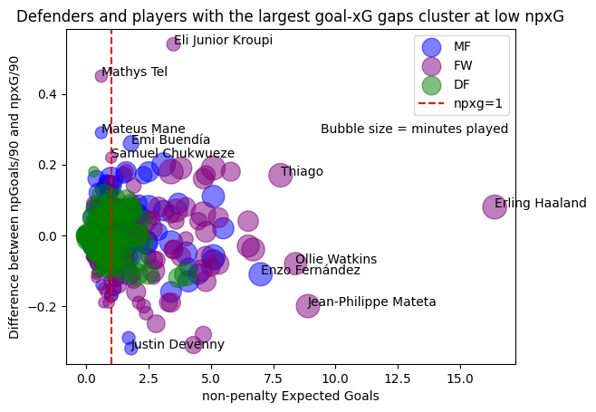

# Premier League Finishing Report

## Research question
Which players over- and underperform their non-penalty expected goals (npxG), and is playing time related to the result?

I rank players within their **club + position group**, so that I can answer a sporting director's question: "Which of my players finish better or worse than their chances suggest, compared with teammates in the same position?" I also calculate the correlation between playing time and non-penalty goals per 90 minus npxG per 90 (npG/90 - npxG/90, `g_xg_diff` in the notebook).

**Tools:** Python, pandas, SQLite (CTEs, window functions: `RANK() OVER`, `COUNT() OVER`, `AVG() OVER`), matplotlib.

The full analysis is in [`PLxGPerformance.ipynb`](PLxGPerformance.ipynb).

## Data
**Source:** FBref player standard stats after 20 matchweeks of the 2025/26 Premier League season, downloaded in January 2026.

I cleaned the data with Excel's Power Query for an earlier project (a Power BI dashboard). The notebook uses 3 of the workbook's 17 sheets: Player Standard Stats (493 players), Player Positions (617 rows, as some players have two positions assigned) and Squad Standard Stats (20 clubs).

**The data files are not included in this repository.** FBref's advanced data, including xG, was supplied by Opta, and some of Sports Reference's data licences do not allow redistribution. On 20 January 2026, FBref removed this data from the site at Opta's request. My dataset was downloaded before that date. As a result, the notebook cannot be re-run without the data file, but all results are visible in its saved outputs.

## Method and filters

| Filter / decision | Effect | Reason |
|---|---|---|
| Minutes played > 300 | 372 players | Roughly three full matches, or 15 minutes in each of the 20 matchweeks; removes marginal substitutes whose per-90 numbers can be distorted by a single late cameo. A judgement call. |
| Goalkeepers excluded | | A finishing metric does not apply to them. |
| One position per player | 92 players had two positions | I keep the primary position, assuming FBref lists it first. Checked against several Liverpool players (e.g. Jeremie Frimpong: FW before DF), but not confirmed in FBref's documentation. |
| npxG ≥ 1 | 33 of 60 club + position groups remain | Balances noise against the number of comparable groups. A judgement call based on 20 matchweeks (see the table below). |
| Groups of at least 3 players | | With one player a ranking says nothing; with two it is a head-to-head, not a position within a group. |
| Defenders excluded | Only 4 of 20 defender groups would remain | Most defenders fall below npxG 1, and shooting is not their primary role, so over half a season this metric says little about them. |
| Ranking | `RANK()` by npG/90 - npxG/90 within each club + position group | `RANK` rather than `DENSE_RANK`: the number shows how many teammates are ranked higher, and ties are real because FBref rounds per-90 values to two decimals. |
| **Result** | **117 players (71 FW, 46 MF)** | |

**Club + position groups with at least 3 players, by npxG threshold:**

| npxG threshold | DF | MF | FW | Total |
|---|---|---|---|---|
| none | 20 | 20 | 17 | 57 |
| ≥ 1 | 4 | 12 | 17 | 33 |
| ≥ 2 | 0 | 2 | 10 | 12 |

A threshold of npxG ≥ 2 leaves only 2 midfielder groups (and 10 of 17 forward groups), so the ranking effectively becomes a ranking of forwards. A threshold of npxG ≥ 1 allows comparison both among forwards (17 groups) and among midfielders (12 of 20 groups).

**The cost of the "at least 3 players" filter:** Erling Haaland is not in the final ranking, only because Manchester City do not have three forwards who pass every filter.

## Chart
All outfield players above the minutes threshold, before the npxG threshold and the exclusion of defenders are applied. Bubble size shows minutes played; the red line marks npxG = 1.

Most of the extreme values come with low npxG, and most defenders fall below npxG 1, which is why both filters are needed.

## Results
- **Biggest overperformers:** Eli Junior Kroupi (+0.54, npxG 3.5) and Samuel Chukwueze (+0.22, npxG 1.0).
- **Biggest underperformers:** Justin Devenny (-0.32, npxG 1.8) and David Brooks (-0.31, npxG 4.3).
- **Extreme values need caution:** Kroupi passes every filter, yet his per-90 overperformance is almost seven times Haaland's, even though Haaland has nearly five times his npxG. Kroupi's figure may reflect a hot streak rather than finishing skill, and Chukwueze sits exactly at the npxG threshold.
- **Playing time:** the correlation between minutes played and npG/90 - npxG/90 is very weak (r ≈ 0.10, all 372 players above 300 minutes), so playing time has almost no relationship with whether a player finishes above or below his npxG. The Pearson correlation is calculated by hand in SQL and checked against pandas `.corr()`.

## Limitations
- **Half a season:** 20 matchweeks are not enough to separate finishing skill from variance.
- **The minutes threshold does not guarantee enough chances.** It shows that a player has played enough to be counted, not that he had enough shots for a reliable npG - npxG. The dataset contains no shot counts.
- **Thresholds are judgement calls:** both 300 minutes and npxG ≥ 1 are reasoned choices, not statistically derived values.
- **Primary position:** taken as the first position listed by FBref, which is an assumption, not a documented rule.
- **Rounding:** FBref rounds per-90 values to two decimals, which creates ties in the ranking.
- **Correlation population:** the correlation uses all 372 players above the minutes threshold, not the final ranking, because npxG depends on minutes played and filtering by it would introduce selection bias.
- **Reproducibility:** the data cannot be downloaded from FBref in this form any more and is not included in the repository.
